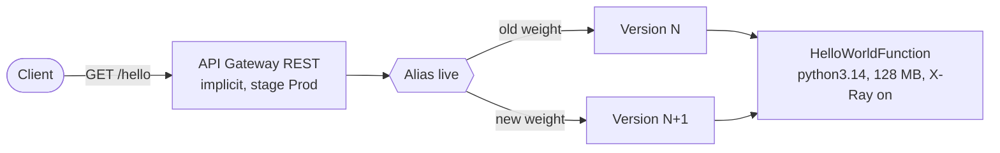
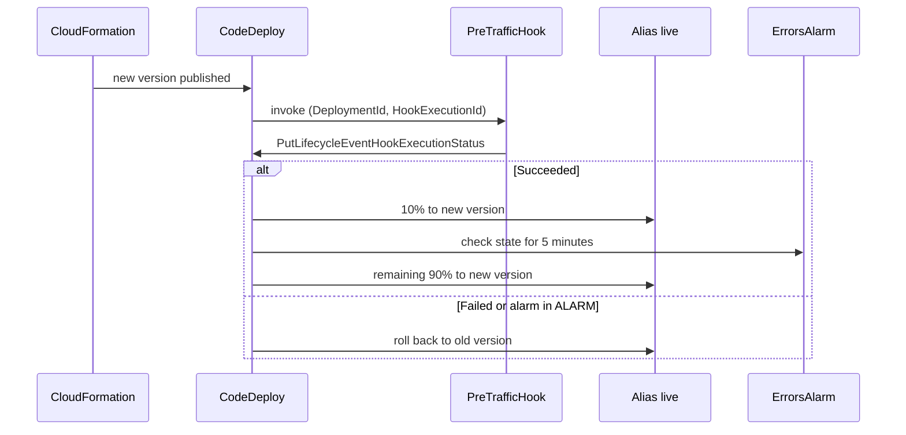

# Infrastructure

The stack as defined in `template.yaml`. Stack name: `aws-deploy-practice`.

`template-cfn.yaml` deploys the same stack with the AWS CLI instead of the SAM CLI. It differs only in where the code comes from:

| Function | `template.yaml` (SAM CLI) | `template-cfn.yaml` (AWS CLI) |
| --- | --- | --- |
| `HelloWorldFunction` | `apps/hello_world/`, built by `sam build` | `build/HelloWorldFunction/`, built by hand with the Makefile |
| `PreTrafficHook` | Inline code | `apps/pre_traffic_hook/src/`, no build step |

## Request path

- API Gateway calls the `live` alias, never `$LATEST`.
- `AutoPublishAlias: live` publishes a new version on every deploy with changed code.

## Gradual deployment

| Resource | Type | Purpose |
| --- | --- | --- |
| `HelloWorldFunction` | `AWS::Serverless::Function` | The app, built from `apps/hello_world` |
| `ErrorsAlarm` | `AWS::CloudWatch::Alarm` | `Errors > 0` on the new version behind `live`, 1-minute period |
| `PreTrafficHook` | `AWS::Serverless::Function` | Inline, or `apps/pre_traffic_hook` in `template-cfn.yaml`. Reports `HOOK_STATUS` to CodeDeploy. Named `CodeDeployHook_*` |
| CodeDeploy app, group, role | Created by SAM | Run the `Canary10Percent5Minutes` shift |
