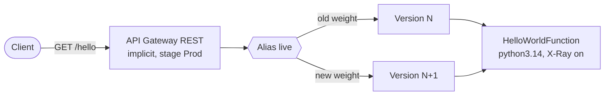
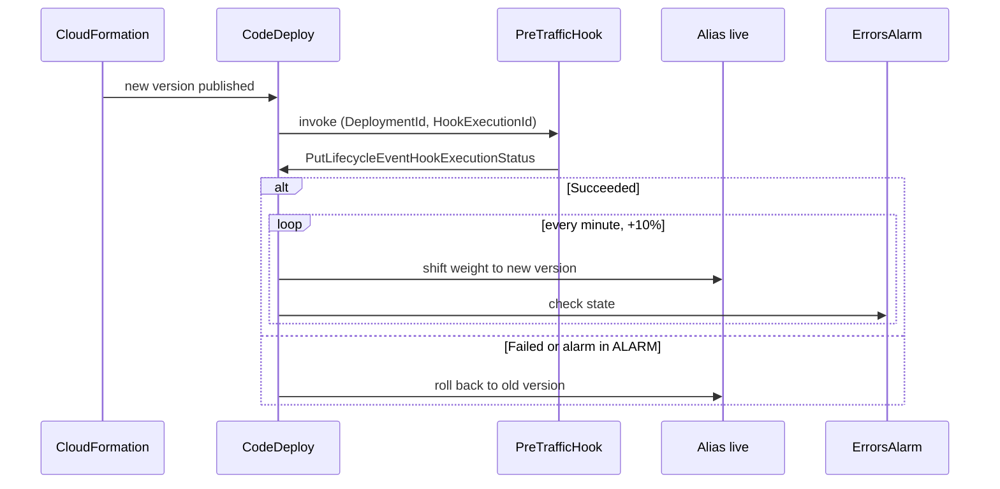

# Infrastructure

The stack as defined in `template.yaml`. Stack name: `aws-deploy-practice`.

## Request path

- API Gateway calls the `live` alias, never `$LATEST`.
- `AutoPublishAlias: live` publishes a new version on every deploy with changed code.

## Gradual deployment

| Resource | Type | Purpose |
| --- | --- | --- |
| `HelloWorldFunction` | `AWS::Serverless::Function` | The app, built from `apps/hello_world` |
| `ErrorsAlarm` | `AWS::CloudWatch::Alarm` | `Errors > 0` on the new version behind `live`, 1-minute period |
| `PreTrafficHook` | `AWS::Serverless::Function` | Inline. Reports `HOOK_STATUS` to CodeDeploy. Named `CodeDeployHook_*` |
| CodeDeploy app, group, role | Created by SAM | Run the `Linear10PercentEvery1Minute` shift |
